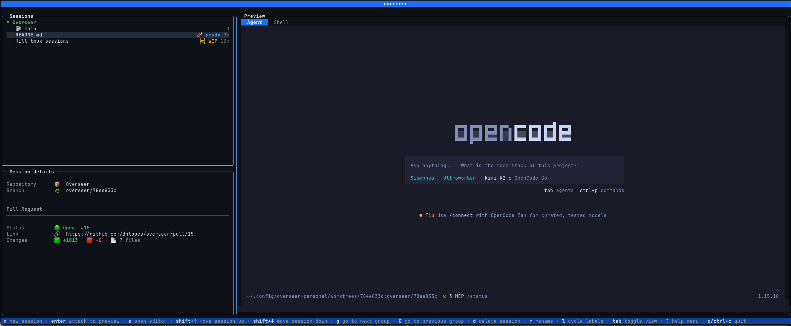
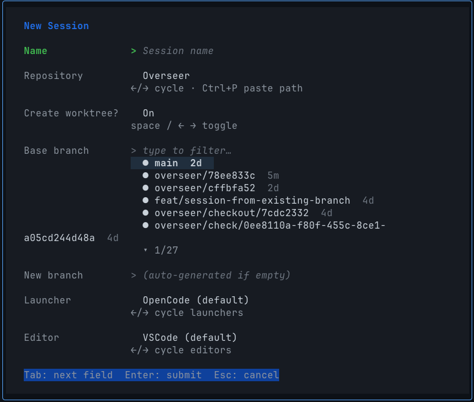
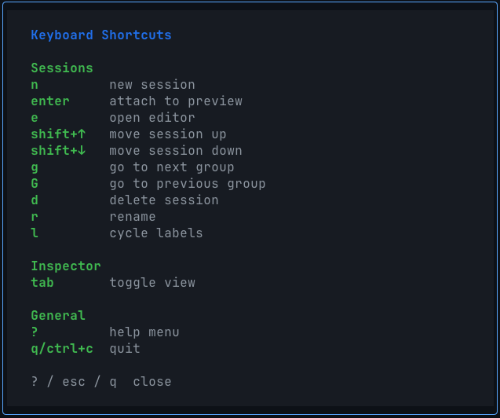

# Skipper

[](https://golang.org/)
[](LICENSE)
[](https://github.com/osesantos/skipper/actions/workflows/build.yaml)

> A terminal cockpit for running a crew of AI coding agents: sessions, pull request reviews and support triage, all from one tmux-backed dashboard.

Skipper starts AI agents (Claude Code, OpenCode, or your own launcher) in tmux sessions, one per task. Each one gets its own Git worktree or works in a project directly.
It watches what every agent is doing and tells you when one needs you.
It also brings the work to you: the pull requests waiting for your review and the support tickets waiting for triage each get an inbox, and Skipper can start an agent on them by itself.

---

## Table of Contents

- [Features](#features)
- [Screenshots](#screenshots)
- [Installation](#installation)
- [Quick Start](#quick-start)
- [Configuration](#configuration)
- [Usage](#usage)
- [Swarm Mode](#swarm-mode)
- [Files and Paths](#files-and-paths)
- [Origins](#origins)
- [License](#license)

---

## Features

### 🧭 Sessions
- **Worktree sessions**: each session gets its own Git worktree on a new branch, so agents never touch your main checkout.
- **Project sessions**: run an agent straight in a project's directory when you don't need isolation.
- **Grouped and ordered**: sessions are grouped by project in a collapsible tree. Reorder them and colour them with labels.
- **Agent status**: every row shows what its agent is doing: running, waiting on a dialog, asking you something, idle or dead.
- **Agents resume**: tmux panes don't survive a reboot, but conversations do. When you attach to a session whose pane is gone, Skipper recreates it and resumes the agent's last Claude Code conversation.

### 🖥️ Terminal
- **tmux underneath**: every session has an agent pane and a shell pane. `Enter` attaches to whichever one the inspector is showing.
- **Live preview**: the inspector streams the agent or shell pane while you stay on the dashboard.
- **Editor tab**: `e` opens `nvim` (or your `editorCommand`) in the session's directory, inside the inspector.
- **Extended keys**: Skipper turns on tmux `extended-keys`, so keys like `Shift+Enter` reach the agent.

### 🔍 Pull requests
- **PR tab**: a session with a pull request gets a `PR` tab (`p`) with the title, merge verdict, your own review state and the description.
- **PR page**: `Enter` on the tab, or `:pr`, opens a full-screen page with Overview, Diff and Comments. The diff is split or unified, themed, and searchable with `/`.
- **Review inbox**: `:prs` lists every open PR that asks for your review, plus the ones you already reviewed.
- **Auto-review**: Skipper can start a review session for each new eligible PR, in a detached worktree at the PR head, with your configured review command.
- **Review icons**: a review session shows 📤 while you have a review staged on GitHub but not submitted, and ✅ once you approved it.

### 🚨 Support triage
- **Triage inbox**: `:triage` lists the Jira tickets your JQL returns, grouped by project (needs `acli`).
- **Auto-triage**: Skipper can start a triage session for fresh, unassigned tickets. Triage sessions stop at their own confirm prompts, so nothing is posted to Jira until you say so.

### ⚓ First Mate
- **A meta-agent**: `Ctrl+O` opens a chat with a Claude-backed agent that can read your sessions' output and send prompts to them for you. It always asks before it acts.
- **Operator commands**: start a message with `/` to run a command directly, without the LLM. `:` runs the same commands from a one-line prompt anywhere.

### 🐝 Swarms
- **Several agents, one goal**: run 2 to 8 agents in a single session, coordinating on a shared message board.
- **Wake-ups**: agent CLIs go idle after each turn, so Skipper nudges them when there is something new to read.

See [Swarm Mode](#swarm-mode) for the details.

### ⌨️ The rest
- **Project discovery**: point Skipper at your code folders and it registers every Git repo it finds at startup.
- **Themes**: twelve palettes, and it follows your [Omarchy](https://omarchy.org) theme live.
- **Keyboard-driven**: vim-style keys throughout. Press `?` for the full list.

---

## Screenshots

The screenshots were taken before the rename, so the title bar still says `overseer`.

### Dashboard and session details



### Creating a session



### Help menu



---

## Installation

### Prerequisites

- **tmux**
- An **AI agent launcher**, such as [Claude Code](https://docs.anthropic.com/en/docs/claude-code) or [OpenCode](https://github.com/opencode-ai/opencode)
- **gh** (GitHub CLI), optional: needed for the PR tab, PR page and review inbox
- **acli** (Atlassian CLI), optional: needed for the triage inbox

### With Go

```bash
go install github.com/osesantos/skipper/cmd/skipper@latest
```

### From source

Requires **Go 1.24+**.

```bash
git clone https://github.com/osesantos/skipper.git
cd skipper
make install
```

`make install` builds `bin/skipper` and copies it to `~/go/bin` and `~/.local/bin`. Set `BIN=` to change the second one.

Prebuilt archives for each release are on the [releases page](https://github.com/osesantos/skipper/releases).

---

## Quick Start

1. **Start it.**

   ```bash
   skipper
   ```

2. **Add a project.** Press `n`. If no project is registered yet, Skipper asks for a Git repository path. Or set `projectDiscovery.paths` in the config and your repos are registered at startup.

3. **Create a session.** Fill in the form. `Tab` / `Shift+Tab` or `↑` / `↓` move between fields.

   | Field | Default | Notes |
   |-------|---------|-------|
   | **Name** | — | A name for the session |
   | **Repository** | — | One of your registered projects |
   | **Create worktree** | Off | Turn on for an isolated branch |
   | **Base branch** | — | The branch to fork from; shown when worktree is on |
   | **New branch** | — | The session's branch; generated if left empty |
   | **Swarm?** | Off | Several agents on one goal; shown when swarms are enabled |
   | **Agents** | 2 | How many agents; shown when Swarm is on |
   | **Goal** | — | What the swarm should do; required when Swarm is on |
   | **Launcher** | Claude Code | The agent to run |

4. **Attach.** Select the session and press `Enter`. `Tab` cycles the inspector tabs:

   | Session type | Tabs |
   |--------------|------|
   | Ordinary | `Agent` · `Shell` · `PR` (when it has one) · `Editor` (after `e`) |
   | Swarm | `Agents Board` · `Agent N/M` · `Shell` · `PR` (when it has one) · `Editor` (after `e`) |

---

## Configuration

Skipper reads `~/.config/skipper/config.yaml` (or `$XDG_CONFIG_HOME/skipper/config.yaml`). Set `SKIPPER_CONFIG_FILE` to use another file. A full example:

```yaml
theme: omarchy
disableEmoji: false

dashboard:
  minWidth: 60
  minHeight: 15
  previewRefreshInterval: 500ms

logging:
  level: info

storage:
  dataDir: ""  # empty uses the default, see Files and Paths

# Scan these directories at startup and register any Git repos in them.
# Only immediate subdirectories are checked. ~ is expanded.
projectDiscovery:
  paths:
    - ~/code
    - ~/projects

launchers:
  - displayName: "Claude Code"
    command: "claude"
    agentType: "claude-code"
  - displayName: "OpenCode"
    command: "opencode"
    agentType: "opencode"

editorCommand: "nvim"

swarm:
  enabled: true
  maxAgents: 8               # highest count the create form offers (2–8)
  nudgeDebounce: 2s          # how often new board activity wakes idle agents
  maxMessagesPerSession: 500 # board cap; 0 turns it off
  boardAddr: "127.0.0.1:0"   # :0 picks a free port. Keep it on loopback.

pullRequests:
  pollInterval: 5m           # how often the review inbox is polled
  autoReview: true           # start review sessions for new eligible PRs
  reviewCommand: 'claude --model opus "/ose-pr-review {{number}}"'  # {{number}} is the PR number
  maxPerPoll: 2              # at most this many review sessions per poll

triage:
  pollInterval: 5m           # how often the triage inbox is polled (needs acli logged in)
  autoTriage: true           # start triage sessions for fresh, unassigned tickets
  jql: 'project in (RDODCF, RDINC) AND statusCategory != Done ORDER BY created DESC'
  projectName: vault         # the registered project triage sessions run in
  commands:                  # launcher per Jira project; {{key}} is the issue key; "" turns one off
    RDODCF: 'claude "/ose-rdodcf-triage {{key}}"'
    RDINC: 'claude "/ose-rdinc-triage {{key}}"'
  maxPerPoll: 1              # at most this many triage sessions per poll
  maxAge: 168h               # older tickets are listed but never auto-triaged

labels:
  - code: "urgent"
    color: "#ff6b6b"
    glyph: "!"
  - code: "wip"
    color: "#feca57"
    glyph: "⋯"
  - code: "done"
    color: "#1dd1a1"
    glyph: "✓"
```

### Options

| Section | Option | Description |
|---------|--------|-------------|
| `theme` | — | `omarchy` (default) or a named palette, see [Themes](#themes) |
| `disableEmoji` | — | `true` swaps emoji glyphs for plain ones |
| `dashboard` | `minWidth`, `minHeight` | Smallest terminal Skipper will draw in |
| `dashboard` | `previewRefreshInterval` | How often the inspector refreshes |
| `logging` | `level` | `debug`, `info`, `warn` or `error`. `SKIPPER_LOG_LEVEL` overrides it |
| `storage` | `dataDir` | Where Skipper keeps its data (absolute path) |
| `projectDiscovery` | `paths` | Folders to scan for Git repos at startup |
| `launchers` | — | Agent launchers: `displayName`, `command`, `agentType` |
| `editorCommand` | — | What the Editor tab runs (default `nvim`) |
| `swarm` | `enabled` | Turns swarms on. When off, the board server never starts |
| `swarm` | `maxAgents` | Highest agent count the create form offers (2–8) |
| `swarm` | `nudgeDebounce` | How often idle agents are woken. Longer batches more chatter into one round |
| `swarm` | `maxMessagesPerSession` | Board cap; later posts get `429`. `0` turns it off |
| `swarm` | `boardAddr` | Where the board server listens. Loopback only: it has no authentication |
| `pullRequests` | `pollInterval`, `autoReview`, `reviewCommand`, `maxPerPoll` | The review inbox and auto-review |
| `triage` | `pollInterval`, `autoTriage`, `jql`, `projectName`, `commands`, `maxPerPoll`, `maxAge` | The triage inbox and auto-triage |
| `labels` | — | Session labels: `code`, `color`, `glyph` |

The `a` toggles on `:prs` and `:triage` are saved, so after the first start they win over `autoReview` and `autoTriage`.

### Themes

- 🎨 **Follows Omarchy.** When `theme` is empty or `omarchy`, Skipper reads the active palette from `~/.local/state/omarchy/current/theme/colors.toml`.
- 🔁 **Repaints live.** Run `omarchy theme set <name>` and a running Skipper changes colour straight away.
- 🎯 **Your choice wins.** A named theme always overrides Omarchy.
- 🌍 **Works anywhere.** Off Omarchy, Skipper uses `dark` or the theme you named.

Named themes: `dark`, `dracula`, `github-dark`, `tokyo-night`, `monokai`, `one-dark`, `solarized-dark`, `nord`, `catppuccin-mocha`, `porcelain`, `deep-sea`, `sunset`.

### Project discovery

When `projectDiscovery.paths` is set, Skipper scans each folder at startup:

- Only immediate subdirectories are checked, with no recursion.
- Folders that aren't Git repos are skipped, and so are repos already registered.
- A toast in the top-right corner shows progress and how many repos were found.
- A configured path that doesn't exist shows a warning at startup. `Enter` or `Esc` closes it.

---

## Usage

### Sessions list

| Key | Action |
|-----|--------|
| `j` / `k` or `↓` / `↑` | Move down / up |
| `Ctrl+↓` / `Ctrl+↑` | Jump down / up |
| `Shift+↓` / `Shift+↑` | Move the session down / up |
| `g` / `G` | Next / previous project group |
| `n` | New session |
| `d` | Delete the session (`p` in the dialog also purges a swarm's board) |
| `r` | Rename the session, or the project on a group row |
| `l` | Cycle labels |
| `Enter` | Attach to the pane the inspector shows; on the `PR` tab, open the PR page |
| `Tab` | Next inspector tab |
| `p` | Jump to the `PR` tab |
| `e` | Open the Editor tab |
| `x` | Kill the pane behind the active tab |
| `o` | Open the session's PR in the browser |
| `Ctrl+E` | Submit the agent's queued prompt (see below) |
| `:` | Command prompt |
| `Ctrl+O` | First Mate chat |
| `?` | Help |
| `q` / `Ctrl+C` | Quit |

`q` only quits when nothing owns the keyboard. While you type in the chat, a board message or a search, use `Ctrl+C`.

**`Ctrl+E` follows the active tab.** On a swarm's `Agent N/M` tab it submits that pane's queued prompt. Anywhere else on a swarm, the Agents Board included, it submits all of them. Sending Enter twice is harmless: it submits a waiting prompt, otherwise it's a newline.

### Agent status icons

| Icon | Meaning |
|------|---------|
| ⚙️ | Running |
| 🙋 | Waiting for you: a permission dialog or a question |
| 💤 | Idle |
| 🟥 | Dead: the agent pane is gone (attach to recreate it) |
| 📤 | A review session whose PR has a review you staged but haven't submitted |
| ✅ | A review session whose PR you approved |
| 🐝 | A swarm (status isn't tracked per agent yet) |

A running or waiting agent always keeps its own icon. With `disableEmoji: true` the glyphs are `● ◐ ○ ■ ⇡ ✓ ⁂`.

### Inspector

| Key | Action |
|-----|--------|
| `Tab` | Cycle the visible tabs |
| `[` / `]` | Previous / next agent (swarm `Agent N/M` tab) |
| `i` | Write to the swarm (Agents Board tab). `Enter` posts, `Esc` cancels |
| `PgUp` / `PgDn` | Scroll the Agents Board |

### PR page (`:pr`)

| Key | Action |
|-----|--------|
| `Tab` / `]`, `[` | Next / previous section (Overview, Diff, Comments) |
| `j` / `k`, `Ctrl+D` / `Ctrl+U` | Scroll |
| `g` / `G` | Top / bottom |
| `s` | Split or unified diff |
| `/` | Search the diff (smartcase); `n` / `N` jump between hits |
| `r` | Fetch again |
| `o` | Open in the browser |
| `Esc` / `q` | Clear the search, then back to the dashboard |

The page refetches by itself when the PR changes on GitHub.

### Review inbox (`:prs`)

Bot-authored and dismissed PRs are hidden. The header says how many, and `h` shows them.

| Key | Action |
|-----|--------|
| `j` / `k` | Move down / up |
| `g` / `G` | Top / bottom |
| `Enter` | Go to the PR's review session, starting one if needed |
| `r` | Start a review session by hand, ignoring the auto-review rules |
| `d` | Dismiss the PR, or restore one you dismissed |
| `o` | Open in the browser |
| `a` | Toggle auto-review (saved) |
| `h` | Show / hide bot and dismissed PRs |
| `R` | Reload now |
| `Esc` / `q` | Back to sessions (also `:sessions`) |

Deleting a review session by hand marks its PR as handled: it stays listed but is never auto-reviewed again. Review sessions are deleted by themselves once their PR is merged or closed.

### Triage inbox (`:triage`)

The same keys as `:prs`. `d` dismisses a ticket, `h` shows dismissed tickets, and `a` toggles auto-triage. Triage sessions are deleted by themselves once their ticket is done.

### First Mate

`Ctrl+O` opens and closes the chat.

| Prefix | Mode | What happens |
|--------|------|--------------|
| none | Agent | The message goes to the First Mate (an LLM call) |
| `/` | Operator | Runs a command, no LLM |

| Command | Description |
|---------|-------------|
| `/send <session> <prompt…>` | Send a prompt to a session's agent |
| `/enter <session>` | Submit the queued prompt in all of a session's agent panes |
| `/delete <session>` | Open the delete dialog |
| `/new` | Open the new-session form |
| `/list` | List all sessions |
| `/prs` | Open the review inbox |
| `/pr` | Open the selected session's PR page |
| `/triage` | Open the triage inbox |
| `/sessions` | Back to the sessions page |
| `/help` | List the commands |

The same commands run from the `:` prompt, without the slash.

In the chat, `↑` / `↓` scroll one line and `PgUp` / `PgDn` one page. New messages only scroll you down if you were already at the bottom. Use `j` / `k` to move through the session list while the chat is open.

### Session modes

- **Worktree session**: a new branch from the base branch, a Git worktree for it, and tmux panes inside it. Deleting the session removes the worktree.
- **Project session** (default): runs in the project's own directory on its current `HEAD`. Nothing about branches changes.

---

## Swarm Mode

A swarm session runs 2 to 8 agents on one goal, talking through a shared message board.

It's for work one agent context handles badly: research across several repos, troubleshooting that needs many queries, broad audits. For a focused task in one codebase, one agent is still the right answer.

### Creating a swarm

Press `n`, turn **Swarm?** on, pick a count and write a goal. Skipper then:

1. Starts one tmux pane per agent (`<session-uuid>-agent-1` … `-agent-N`)
2. Writes a descriptor the agents read
3. Posts your goal as the board's first message
4. Briefs each agent on who it is and how the board works

### The Agents Board

The **Agents Board** tab is a live transcript with a colour per agent. Each post starts with its number:

```
#7    10:43:43 agent-3
The precedent claim is FALSE. No cross-revision addressing exists here.
────────────────────────────────────────────────────────────────────────
#25   10:53:20 agent-1
Resolving @agent-2 #21 vs @agent-3 #24 — you are both right about
different halves.
```

Agents cite each other by that number all the time (86% of posts did in one run), so it has to be on screen. Bodies render as markdown. Paste works in the compose line.

### How the agents are told to work

The descriptor ships a short method. Each rule comes from a measured run, not general prompt advice:

- **Try to break your own claim before posting it.** The run where agents did this 11 times had 5 reversals; the run where they never did had 10.
- **Claim an axis nobody else holds; the earliest claim wins.** Agents had been duplicating work.
- **State your confidence and what would change your mind.**
- **Close an open finding before opening another.**
- **Post a verdict when the goal is answered, without being asked.** Neither run did this by itself.

Tune them in `boardMethod` in `internal/adapters/secondary/swarmboard/board.go`. Its sibling `boardConventions` sets how posts are written. Keep the two apart.

### Keeping posts readable

Left alone, agents write essays: one five-agent run averaged about 3 KB a post. The conventions ask for one bold claim line, about twelve lines at most, numbers and paths over prose, and a `#seq` instead of repeating the board.

They target prose, not evidence: the tables and numbers inside long posts are what catch a bad premise. `maxMessagesPerSession` caps how many posts there are, not how long they are. There's no length cap to tune, because a rejected post is work already paid for.

### How agents stay in sync

Agent CLIs don't loop. They finish a turn and wait at their prompt, so on its own a board is a mailbox with no doorbell.

Skipper is the doorbell. On every `nudgeDebounce` tick it types a short "read the board" line into each idle agent's pane, skipping whoever posted last. A burst of posts in one tick costs one round of wake-ups, which keeps a swarm from talking itself into a loop. The board also rejects posts past `maxMessagesPerSession` with `429`.

### Working directory

All agents share the session's directory. That suits read-heavy work. For writes, agents are told to claim a file on the board first, but nothing enforces it.

### The board API

A loopback HTTP server on a free port, started when `swarm.enabled` is true. Agents get the exact calls in their descriptor; this is for debugging:

| Method | Path | Purpose |
|--------|------|---------|
| `POST` | `/v1/sessions/{id}/messages` | Post `{"author":"agent-2","content":"…"}` |
| `GET` | `/v1/sessions/{id}/messages?since=N` | Read messages after `N` |
| `GET` | `/healthz` | Liveness |

`201` on post, `400` malformed, `404` unknown or non-swarm session, `429` cap reached.

> **The board has no authentication.** Any local process can post to it. Keep `boardAddr` on loopback.

### Board history

Boards live under the data dir (see below), never in your repo. They survive a restart and deleting the session, because the transcript is often worth more than the session. Press `p` in the delete dialog to purge it too. Nothing prunes old boards for you.

### Starting up

A new pane exists in milliseconds, but the agent CLI takes seconds to accept input. Skipper types each briefing straight away and submits it a few times from a background job. If a cold start outlasts that, press `Ctrl+E` on the Agents Board or run `/enter <session>`.

### Current limitations

- **No per-agent status.** A swarm shows 🐝 instead of running / waiting / idle.
- **Startup submission is retried, not detected.** `Ctrl+E` is the backstop.
- **No re-briefing after a restart.** Post to the board to get the agents moving.
- **`nudgeDebounce` is untuned.** `2s` is a starting point.
- **Cost scales with agent count.** N agents means roughly N times the tokens.

---

## Files and Paths

| What | Where |
|------|-------|
| Config | `~/.config/skipper/config.yaml`, or `$XDG_CONFIG_HOME/skipper/`, or `SKIPPER_CONFIG_FILE` |
| Data (`data.json`, worktrees, swarm boards) | `~/.local/share/skipper/`, or `$XDG_DATA_HOME/skipper/`, or `storage.dataDir` |
| Log | `~/.local/state/skipper/skipper.log`, or `$XDG_STATE_HOME/skipper/` |

Worktree sessions get branches named `skipper/<short-id>`.

**Upgrading from Overseer.** If the `skipper` config or data folder doesn't exist but the old `overseer` one does, Skipper keeps using the old one. Your sessions, worktrees and agent conversations carry on as before. Once you move the folder (and the worktrees in it), the new one is used.

---

## Origins

Skipper started as a fork of [dnlopes/overseer](https://github.com/dnlopes/overseer) by David Lopes. It has since grown its own review, triage and swarm features and is maintained here as a separate project.

Bugs and ideas are welcome as [issues](https://github.com/osesantos/skipper/issues). See [CONTRIBUTING.md](CONTRIBUTING.md) to build and test it.

---

## License

[MIT](LICENSE). © José Santos, with portions © David Lopes.
